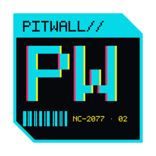
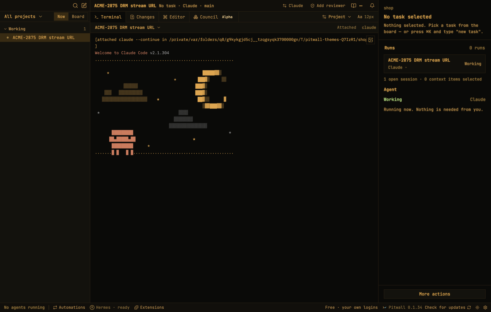
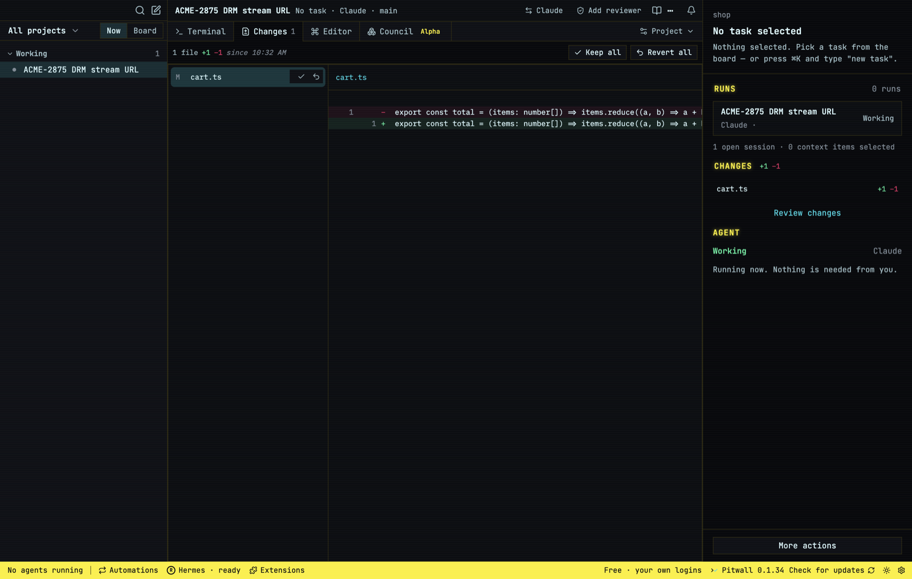
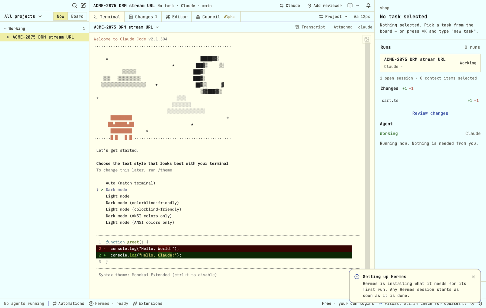
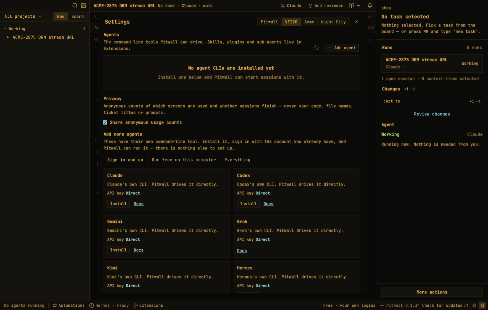

<p align="center"></p>

# Pitwall

A Mac app for running coding agents across all your projects, from one screen. Every change is reviewed before it merges.

Pitwall drives the agent CLIs you already use — Claude Code, Codex, Gemini, Grok, Kimi, Hermes or your own — in real terminals, signed in with your own accounts. Each task gets its own git worktree and branch, you watch the agent's changes arrive live, and you keep or revert them file by file before anything is pushed.



## What it does

| | |
|---|---|
| **One screen for every project** | A sidebar of projects and tasks, grouped by what needs you, what is being reviewed, what is working and what shipped. **Now** shows the work in front of you; **Board** shows everything. |
| **Agents in real terminals** | Sessions run the agent's own CLI in a terminal inside Pitwall, so its commands, prompts and keys work as they do in your shell. Pitwall uses your logins; it never resells or proxies model access. |
| **A worktree per task** | Each task runs in its own git worktree on its own branch, so agents never trip over each other or over your checkout. The agent cuts the branch and opens the pull request (`gh` on GitHub, `glab` on GitLab). |
| **Live Changes** | The Changes tab shows what the agent has changed since the session started, as it happens. Keep or revert a file, revert a single hunk, or keep or revert everything. |
| **Review before merge** | Add a reviewer to any session: a second agent reads the diff and approves it or sends it back. Optionally, Hermes acts as each project's long-term reviewer and learns the project as it goes. |
| **Council (alpha)** | Several agents in roles — implementer, architect, reviewer — work one task in a shared thread. A conductor reads the discussion after every turn and decides who speaks next, and every turn is checked against the worktree and the test suite. |
| **Automations** | Watches find work and draft a proposal for you to approve: review requests, failing CI on your pull request, new comments, and tickets assigned to you in Jira or Linear (through their MCP servers). Nothing is posted, pushed or created until you approve. |
| **Extensions** | Per-project MCP servers and skills, with their sign-ins kept per project. |
| **Recovery** | Sessions survive a crash or restart: Pitwall reattaches to what was running and tells you what it could not bring back. |
| **Voice** | An optional wake word and spoken requests, transcribed on your Mac. See [VOICE.md](VOICE.md). |
| **Themes** | Pitwall, VT220, Acme and Night City. |







## Install

Download the latest `Pitwall-<version>-arm64.dmg` from [Releases](https://github.com/braveson008/pitwall/releases), open it and drag Pitwall to Applications. Builds are signed and notarised for Apple Silicon Macs running macOS 12 or later.

Pitwall updates itself from this repository's releases: it downloads a new version in the background and installs it when you restart.

You also need at least one agent CLI installed and signed in, for example [Claude Code](https://docs.claude.com/en/docs/claude-code) or [Codex](https://github.com/openai/codex). Settings → Agents lists the ones Pitwall supports and installs them for you. For pull requests, install and sign in to `gh` or `glab`.

## Build from source

Use Node 24.15 or newer and the macOS command line developer tools (for the native terminal module).

```bash
npm ci
npm run dev      # Vite + Electron, with hot reload
npm test         # unit tests
npm run dist     # an unsigned local build in release/
```

`npm run test:electron` runs the end-to-end smokes against the built app with stubbed agent CLIs. `npm run icons` redraws the app icon from `scripts/make-icons.mjs`.

## Privacy

Projects, tasks, sessions and terminal history stay on your Mac. Agents talk to their own providers with your own accounts. GitHub and GitLab tokens are encrypted with macOS safe storage. See [SECURITY.md](SECURITY.md) for what an unattended agent can do.

## History

Pitwall began as an app called Braveli, so some internal names (environment variables, the renderer bridge) still say `braveli`.

## License

[Apache-2.0](LICENSE). Third-party components are listed in [THIRD_PARTY_NOTICES.md](THIRD_PARTY_NOTICES.md).
